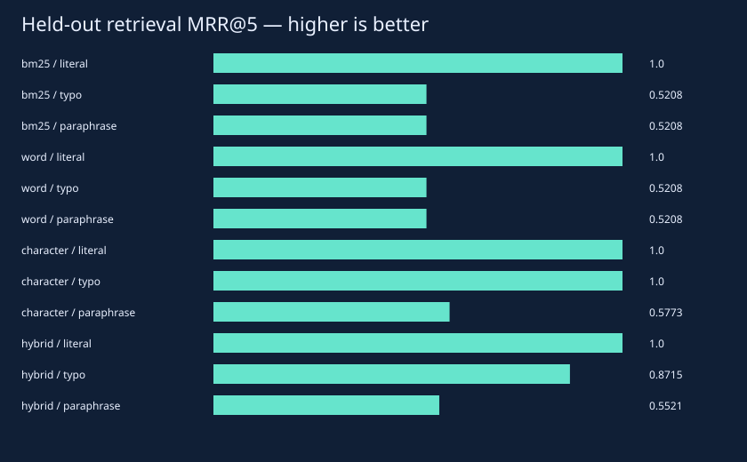
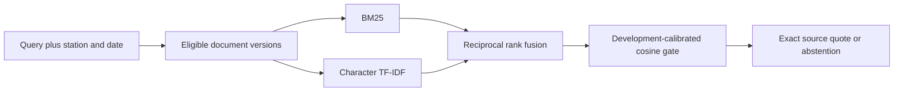

# Retrieval Observatory

**Every ranking, every citation, every failure.**

[](https://github.com/aymaw/retrieval-observatory/actions/workflows/ci.yml)
[](LICENSE)




New original, AI-assisted personal work, November 2026. All task data are synthetic.
No API key, pretrained download or private data is required. See [provenance](PROVENANCE.md).

## Run it

```bash
# Python 3.11–3.13. uv.lock freezes the dependency graph.
uv sync --frozen --extra dev
uv run pytest -q
uv run python -m retrievalobs.experiment --out runs/reference
uv run python -m http.server 8765 --bind 127.0.0.1
```

Open `http://127.0.0.1:8765/runs/reference/demo.html` for the new run, or
`http://127.0.0.1:8765/results/demo.html` for the committed measured report.
The self-contained HTML also opens directly from disk. Stop the local server with Ctrl+C.

For a short correctness run, add `--quick --out runs/smoke`. Quick output is explicitly
labeled and is not the committed reference result. Training and checkpoints stay in
ignored `runs/`; reports include seeds/configuration, raw metrics and environment details.

## Inside the experiment

A fictional orbital-station manual corpus contains 192 documents: four stations,
six systems, four procedure topics and two versions. Search filters station and
half-open validity intervals before ranking candidates, excluding outdated versions.
All index contents are public synthetic fixtures; these filters are not an access
control system and corpus-wide document frequencies are not tenant-isolated.

Compare hand-implemented BM25 (k1=1.2, b=0.75), word/bigram TF-IDF, character 3–5-gram
TF-IDF, and reciprocal rank fusion of BM25 and character rankings. RRF sums
`1/(60 + rank)` for each child rank in a fixed 20-document window. No pretrained
embedding or language model is used. Character overlap is not semantic understanding.

The extractive answer returns one complete source document as a quote, or abstains.
A word-cosine threshold is selected on 120 development queries using balanced
answerability accuracy; a higher cutoff wins ties. The same frozen threshold is
applied to all ranking ablations. This intentionally simple gate can reject a
correct typo-tolerant retrieval and can accept an unsupported question.



## Measured result

| Retriever | Slice | MRR@5 | Correct evidence rate |
| --- | --- | --- | --- |
| bm25 | literal | 1.0 | 1.0 |
| bm25 | typo | 0.5208 | 0.0 |
| bm25 | paraphrase | 0.5208 | 0.0 |
| word | literal | 1.0 | 1.0 |
| word | typo | 0.5208 | 0.0 |
| word | paraphrase | 0.5208 | 0.0 |
| character | literal | 1.0 | 1.0 |
| character | typo | 1.0 | 0.0 |
| character | paraphrase | 0.5773 | 0.0 |
| hybrid | literal | 1.0 | 1.0 |
| hybrid | typo | 0.8715 | 0.0 |
| hybrid | paraphrase | 0.5521 | 0.0 |

Hybrid unsupported false-answer rate: **0.0208**. Returned-citation integrity: **1.000**. The typo/paraphrase gate over-abstains despite useful ranking gains; this limitation is retained.


The held-out set contains 336 queries: 96 literal, 96 typo, 96 paraphrase and 48
unsupported. Development and test query strings use distinct authored templates;
fixtures share the same tiny domain vocabulary and are not a natural-language
population sample. Each answerable query has one graded relevant document.
Recall@5, MRR@5 and binary nDCG@5 are ranking metrics. Correct-evidence rate additionally
requires a returned citation to the relevant document, so abstention counts as failure.
Repetitive fixtures make recall@5 easy; MRR and unsupported-answer behavior are more revealing.

## Visual demo

Select any held-out query to inspect its station, slice, ranked IDs, gate score,
relevance label, exact quote, offsets and source hash. Citation verification checks
that document identity, SHA-256 and Unicode character offsets match the source.
It detects tampering; it does not authenticate an untrusted corpus, establish
entailment, or prove the selected document answers the question.

## Tests and limits

Tests cover the RRF formula, candidate windows, station/time filtering, exact
citation offsets and tampering, abstention, hand-calculated ranking metrics,
spelling tolerance and template separation. Quoted instruction-like text is data;
there is no model/tool execution layer. This is not a prompt-injection defense
benchmark. No generated-answer, external-web retrieval, vector database, learned
reranker, semantic model, latency SLO or production authorization claim is made.

## Method references

- [Elasticsearch RRF specification](https://www.elastic.co/docs/reference/elasticsearch/rest-apis/reciprocal-rank-fusion).
- [scikit-learn TF-IDF documentation](https://scikit-learn.org/1.7/modules/generated/sklearn.feature_extraction.text.TfidfVectorizer.html).

## Code map

- `src/retrievalobs/core.py`: mathematical and inference primitives.
- `src/retrievalobs/experiment.py`: seeded experiment and CLI.
- `src/retrievalobs/visual.py`: dependency-free HTML/SVG reports.
- `tests/`: mathematical checks and failure-path regressions.
- `results/`: executed measurements, static preview, interactive report and provenance.
- `.github/workflows/ci.yml`: frozen install, lint, tests, quick experiment and package build on three Python versions.

Original implementation and generated fixtures: [MIT](LICENSE).
